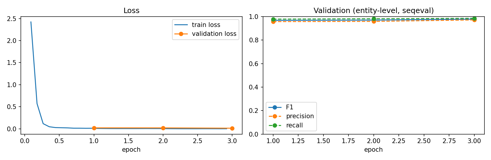

# Mintx Assistant

**A Chrome side-panel AI assistant that can read the page you are on, without sending anyone's personal data to the model.**

Before anything leaves the browser, a local multi-layer PII engine finds names, contact details, ID numbers and secrets. It replaces them with placeholders such as `[PERSON_1]` and keeps the real values in an on-device vault. The LLM answers using only the placeholders, and the browser restores the real values in the answer. You see a normal answer; the model never saw the data.

```
 You ask a question (Alt+M)
        │
 ① READ      active tab only, only when you send: visible text, selection, form values
        │    (password fields and hidden elements are never read)
 ② DETECT    4 layers, all running in the browser
        │      Rules + checksums  · Secrets + entropy · Linguistic NER · Transformer NER (BERT)
 ③ FUSE      combine the layers' votes (noisy-OR), resolve "Priya" → "Priya Sharma", mask repeats
        │
 ④ REPLACE   Priya Sharma → [PERSON_1]   (vault stays on the device; optional human review)
        │
 ⑤ GUARD     server re-scans for leftover emails, cards, Aadhaar, PAN or keys and blocks the request if any remain
        │
 ⑥ LLM       answers with placeholders: "Hi [PERSON_1], …"
        │
 ⑦ RESTORE   browser swaps real values back, highlighted in the answer
```

## Contents

- [Quick start](#quick-start)
- [Try the test scenarios](#try-the-test-scenarios)
- [How the privacy layer works](#how-the-privacy-layer-works)
- [Evaluation](#evaluation)
- [Project structure](#project-structure)
- [Configuration](#configuration)
- [Limitations](#limitations)
- [Third-party components](#third-party-components)

## Quick start

**You need:** Python 3.11+, Google Chrome 116+, and [Ollama](https://ollama.com) for real answers. Ollama is optional: a dummy mode works offline.

```bash
git clone <your-repo-url>
cd <repo-folder>
python -m pip install -r requirements.txt
ollama pull qwen2.5:7b          # skip if you only want dummy mode
```

**1. Start the server.** Keep this terminal open while you use the assistant.

```powershell
# Windows
powershell -ExecutionPolicy Bypass -File .\start.ps1              # real answers (Ollama, qwen2.5:7b)
powershell -ExecutionPolicy Bypass -File .\start.ps1 -Mode dummy  # instant offline replies
```

```bash
# macOS / Linux
sh start.sh          # real answers
sh start.sh dummy    # offline replies
```

**2. Load the extension** (one time).
1. Go to `chrome://extensions` and turn on **Developer mode**.
2. Click **Load unpacked** and select the **`assistant`** folder.
3. Pin **Mintx Assistant** from the puzzle-piece menu.

**3. Use it.** Open any web page, press **Alt+M** (or click the shield icon) and ask a question. The status pill at the top shows the model name in green when the server is reachable.

On first use the fine-tuned PII model (66 MB) downloads from Hugging Face and is cached. To prepare an offline demo, run `python assistant/fetch_model.py` once. To compare with the generic model, choose **Generic NER** under settings ⚙ → Transformer model. With a CPU-only local 7B model, expect answers to take tens of seconds; the privacy card fills in immediately.

## Try the test scenarios

Open **http://127.0.0.1:8765/samples/** while the server runs. Each page is synthetic: every person, number and key on it is fake.

| # | Page | Ask | What to look for |
| --- | --- | --- | --- |
| 1 | Support ticket | "Draft a short reply to the customer and list what you need from finance." | About 17 values masked, including Indian IDs. "Priya", "Sharma" and "Priya Sharma" share one placeholder. |
| 2 | Build log | "Why did this build fail and how do I fix it?" | Keys, tokens and the database password are hidden. Commit hash, versions and the error message stay readable. |
| 3 | Patient form | "Check this form for missing or inconsistent details." | Typed form values are masked. The password field is never read. |
| 4 | News article | "Summarize this article in three bullet points." | Numbers and dates are kept. Some places and organizations are masked: the privacy-versus-utility trade-off. |
| 5 | Prompt injection | "Summarize my order." | Hidden instructions are not read. A visible attack only has placeholders to work with, and answers cannot load images or links. |

The hub page also lists seven feature checks:
- follow-up questions reuse the same placeholders
- review before sending
- the server guard (switch off a layer in settings ⚙)
- synthetic surrogate names
- sensitivity levels
- right-click **Ask Mintx about the selection**
- graceful failure on unreadable pages or with the server down

In every run, expand the privacy card and click **What the model sees**. That text is the only page content that leaves the browser.

### Automated tests

```bash
python -m playwright install chromium
node assistant/test/evaluate.mjs        # detection accuracy per layer (rules, secrets, NLP)
python assistant/test/scenarios.py      # all 12 scenarios end to end, real extension in Chromium
python assistant/test/system_eval.py    # whole engine on the realistic set: rules vs + generic BERT vs + fine-tuned
```

`scenarios.py` starts its own dummy-mode server on port 8771, so it doesn't need Ollama or a free port 8765. It currently passes 73 of 73 checks. Trade-offs that are not pass/fail, such as how many organizations were masked, are printed as `NOTE` lines.

## How the privacy layer works

| Stage | Technique | Type | Code |
| --- | --- | --- | --- |
| Transformer NER | **Our fine-tuned model** [`Preetm-666/mintx-pii-distilbert`](https://huggingface.co/Preetm-666/mintx-pii-distilbert): DistilBERT trained on 26k labelled examples to tag all 13 PII types and leave public names visible ([how it was built](#fine-tuned-pii-model)). The generic `bert-base-NER` (CoNLL-2003) is still available in settings. Both are int8 ONNX models run by transformers.js and WebAssembly in a Web Worker. | **Learned model, trained by us** | `assistant/pii/ner-worker.js`, `ml/` |
| Answering | Local LLM (default `qwen2.5:7b` via Ollama), instructed to keep placeholders verbatim and to treat page text as untrusted | **Learned model** | `chat.py` |
| Rules + checksums | Regex candidates confirmed by Luhn (cards), Verhoeff (Aadhaar) and ISO 13616 mod-97 (IBAN). Context words ("DOB", "phone") raise confidence, as in Microsoft Presidio. Structural cues: `Customer: …`, `Name <email>`. | Symbolic | `assistant/pii/patterns.js` |
| Secrets + entropy | Signatures for OpenAI, GitHub, AWS, Stripe, Slack, JWT and private keys; passwords in connection URLs and `password: …` assignments. Shannon entropy in bits per character catches unknown keys. | Statistical | `assistant/pii/secrets.js` |
| Linguistic NER | Compromise lexicon and part-of-speech rules. Fast, with no download. | Symbolic NLP | `assistant/pii/nlp.js` |
| Ensemble fusion | Overlapping candidates are clustered. Evidence is pooled per type family (the rules' `AADHAAR` and the model's `GOV_ID` vote together) and combined with noisy-OR, 1 − Π(1 − pᵢ), so independent detectors that agree reinforce each other. Confident specific types beat generic NER labels. A domain stoplist keeps words like "Aadhaar" from being masked. | Probabilistic | `assistant/pii/engine.js` |
| Entity resolution | Coreference ("Priya" → "Priya Sharma"), email-to-name inference (`vikram.nair@…` → "Vikram Nair") and propagation, which masks every repeat of a detected value | Heuristic | `assistant/pii/engine.js` |
| Policy | Confidence threshold: strict 0.35, balanced 0.5, relaxed 0.7. Each layer can be switched off. Candidates below the threshold are listed, not hidden. | | settings ⚙ |
| Pseudonymization | Reversible and consistent across a conversation: typed tags (`[EMAIL_1]`) or synthetic surrogates (`Alex Morgan`, `user1@example.com`) | | `assistant/pii/vault.js` |
| Human in the loop | **Review before sending** shows the exact payload. **Share** reveals a value deliberately. | | `assistant/panel.js` |
| Defense in depth | The server independently re-scans every request and rejects unmasked identifiers unless the user approved them (sent as SHA-256 hashes). No request content is logged. | | `chat.py` |

## Fine-tuned PII model

The generic NER model was built for news: it tags *Google* and *USA* (correct for news, wrong for privacy) and knows nothing about Aadhaar, UPI or API keys. So we trained our own.

1. **Dataset** (`ml/data/`, [Hugging Face](https://huggingface.co/datasets/Preetm-666/mintx-pii)). 33k examples labelled to a written [policy](ml/data/labeling_policy.md):
   - a template generator with checksum-valid Indian and global identifiers and public-entity "keep" examples
   - a sample of *OpenPII 1.5M*, relabelled by rule (weak supervision)
   - 61 hand-checked realistic texts, used only for testing
2. **Training** ([`ml/train_ner.ipynb`](ml/train_ner.ipynb), Kaggle T4, 22 min). `distilbert-base-cased` fine-tuned for BIO token classification (27 tags), 3 epochs, rare labels oversampled ×4.
3. **Deployment.** Exported to ONNX, quantized to int8 (261 → 66 MB), and published to the Hub in transformers.js layout. The extension downloads it once and runs it in the browser.

**Model vs the generic baseline** (character-span evaluation; *privacy recall* = share of personal values fully covered):

| Test set | Model | Exact F1 | Privacy recall | Over-masking | Public names kept |
| --- | --- | ---: | ---: | ---: | ---: |
| Held-out templates (1,885 values) | generic BERT | 0.278 | 0.553 | 0.205 | 0.041 |
| | **fine-tuned** | **0.893** | **0.993** | **0.039** | **0.851** |
| ai4privacy validation (12,666 values) | generic BERT | 0.070 | 0.161 | 0.100 | 0.133 |
| | **fine-tuned** | **0.986** | **0.995** | **0.006** | **0.976** |
| Realistic, hand-checked (98 values) | generic BERT | 0.190 | 0.500 | 0.355 | 0.212 |
| | **fine-tuned** | **0.715** | **0.867** | **0.147** | **0.885** |

**Whole system in the browser** (all layers + fusion, int8 models, realistic set; `python assistant/test/system_eval.py`):

| Configuration | Privacy recall | Over-masking | Public names kept | Typed F1 |
| --- | ---: | ---: | ---: | ---: |
| Rules + secrets + linguistic NER | 0.439 | 0.043 | 1.000 | 0.593 |
| + generic BERT | 0.786 | 0.331 | 0.288 | 0.658 |
| **+ fine-tuned model** | **0.847** | **0.082** | **0.942** | **0.837** |
| Fine-tuned model alone | 0.765 | 0.083 | 0.942 | 0.784 |

The fine-tuned model is better on every measure and faster (133 vs 220 ms per text). The rules still add value on top of it: privacy recall rises from 0.765 to 0.847 because checksums and patterns catch what the model splits or mislabels.

**Quantization cost.** int8 matched fp32 on the held-out templates (exact F1 0.903 vs 0.893). On the 98-value realistic set, privacy recall fell from 0.867 to 0.806, about 6 values. It runs about 2× faster on CPU and is 4× smaller.

<p align="center"></p>

**Error analysis** ([full list](ml/results/mintx-pii-distilbert/realistic_errors.txt)). Most errors trace back to the training data, which makes them good targets for the next round:
- **Capitalized first words become PERSON** ("Hiring:", "Dear Parent", "Error 403"): the chat templates put names at the start of lines.
- **All-caps names become GOV_ID** ("MOHAMMED IRFAN SHAIKH"): ai4privacy IDs are random capital letters.
- **Cities are the weakest label** (F1 0.66 on held-out templates): often missed or confused with organizations.
- **Public names in a new context** ("Applied to Infosys, TCS and Wipro", "Sundar Pichai") were still masked. The keep examples come from too few templates.

## Evaluation

Detection was measured on a synthetic labelled corpus (`assistant/test/corpus.mjs`): 12 texts, 32 gold values, and decoys such as invoice numbers, versions and dates. The rule-based rows come from `node assistant/test/evaluate.mjs`; the transformer rows were measured inside the extension in Chromium.

| Layers | Recall | Precision | F1 |
| --- | ---: | ---: | ---: |
| Rules | 56.3% | 100% | 0.720 |
| Rules + secrets | 65.6% | 100% | 0.792 |
| Rules + secrets + linguistic NER | 78.1% | 100% | 0.877 |
| Transformer NER only | 46.9% | 94.1% | 0.626 |
| **All four layers** | **100%** | **96.9%** | **0.984** |

The layers are complementary. The transformer finds organizations and places but no identifiers; the rules find identifiers but miss most names. No configuration masked a decoy, and every pseudonymized text restored exactly.

In an end-to-end run on the support ticket with `qwen2.5:7b`, 17 values were replaced and none of the 16 known sensitive strings reached the model. The draft reply used only placeholders, and the panel restored them locally.

This is a small synthetic benchmark. It shows how the layers interact; it does not estimate real-world recall.

## Project structure

```
├── assistant/                  Chrome extension (load this folder)
│   ├── manifest.json
│   ├── worker.js               opens the side panel, context menu
│   ├── extract.js              injected on demand; reads text, selection, form fields
│   ├── panel.html/.css/.js     chat UI and pipeline orchestration
│   ├── markdown.js             safe renderer (no HTML, images or links)
│   ├── pii/
│   │   ├── patterns.js         layer 1: rules, checksums, context, structure
│   │   ├── secrets.js          layer 2: signatures and entropy
│   │   ├── nlp.js              layer 3: Compromise NER
│   │   ├── ner-worker.js       layer 4: BERT NER in a Web Worker
│   │   ├── neural.js           client for the worker
│   │   ├── neural-core.js      chunking and token aggregation
│   │   ├── engine.js           fusion, coreference, propagation, policy
│   │   └── vault.js            pseudonymization and restoration
│   ├── test/                   corpus, metrics, scenario runner
│   ├── vendor/                 bundled libraries (no remote code at runtime)
│   ├── icons/
│   └── fetch_model.py          optional: download the transformer models for offline use
├── ml/                         dataset, training notebook, results (see ml/README.md)
│   ├── data/                   generator, relabelling, labelling policy, realistic test set
│   ├── train_ner.ipynb         fine-tuning → evaluation → ONNX/int8 → Hugging Face
│   └── results/                metrics, curves, confusion matrix, error list
├── samples/                    synthetic test pages and scenario hub
├── server.py                   FastAPI app
├── chat.py                     /chat endpoint, egress guard, LLM streaming
├── start.ps1 / start.sh        start the server
└── requirements.txt
```

## Configuration

| Variable | Default | Meaning |
| --- | --- | --- |
| `MINTX_MODE` | `dummy` | `llm` for real answers. The start scripts default to `llm`. |
| `MINTX_CHAT_MODEL` | `qwen2.5:7b` | Model name at the endpoint |
| `MINTX_ENDPOINT` | `http://127.0.0.1:11434/v1/chat/completions` | Any OpenAI-compatible chat completions URL |
| `MINTX_API_KEY` | none | Only if the endpoint needs one |

In the panel's settings ⚙ you can switch layers on or off, set sensitivity, choose placeholder or surrogate replacement, cap the number of page characters sent, and change the server URL.

## Limitations

- **Detection coverage.** The BERT model is English-only. Names it doesn't recognize and that no rule or email link covers can still get through. Images and PDFs inside pages are not scanned.
- **Over-masking.** Organizations and places are masked by default. That protects quasi-identifiers but can remove useful context; use **Relaxed** or **Share** when it matters.
- **Indirect identifiers.** Something like "the CEO of a small startup" is not detected.
- **Permissions.** The extension requests access to all sites so it can read whichever tab you ask about. It reads a page only when you send a message.
- **What the guard covers.** The server guard is a safety net for high-confidence identifiers, not a full second detector.

## Third-party components

All are bundled in `assistant/vendor/`; no code is loaded remotely.

| Component | License | Use |
| --- | --- | --- |
| [Compromise](https://github.com/spencermountain/compromise) | MIT | Linguistic NER |
| [Transformers.js](https://github.com/huggingface/transformers.js) 3.8.1 | Apache-2.0 | Runs the BERT model |
| [ONNX Runtime Web](https://github.com/microsoft/onnxruntime) | MIT | WebAssembly inference (included in the transformers.js bundle) |
| [`Xenova/bert-base-NER`](https://huggingface.co/Xenova/bert-base-NER) | MIT | ONNX conversion of `dslim/bert-base-NER`, downloaded at runtime |
| [`distilbert-base-cased`](https://huggingface.co/distilbert/distilbert-base-cased) | Apache-2.0 | Base model for our fine-tuned PII model |
| [OpenPII 1.5M](https://huggingface.co/datasets/ai4privacy/pii-masking-openpii-1.5m), Ai4Privacy / Ai Suisse SA | CC-BY-4.0 | Part of the training data, relabelled |
