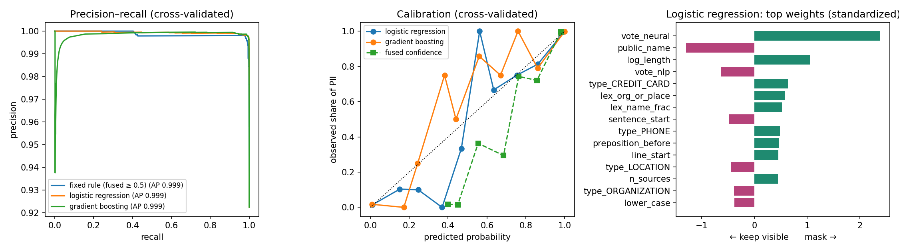

# Mintx ML

Training data and models for the Mintx privacy layer.

| Step | Status | What |
| --- | --- | --- |
| 1. Dataset | ✅ done | Labelled PII dataset: synthetic generator + relabelled ai4privacy + hand-checked realistic set |
| 2. Learned classifier | ✅ done | "Mask or keep?" logistic regression on 38 features from all layers; replaces the fixed threshold. See [Step 2](#step-2-learned-decision-classifier) |
| 3. Fine-tuned transformer | ✅ done | DistilBERT fine-tuned for PII token classification (Kaggle GPU), hosted on Hugging Face, run in the browser. See [`train_ner.ipynb`](train_ner.ipynb), [`TRAINING.md`](TRAINING.md), [results](results/mintx-pii-distilbert/) and the model on [Hugging Face](https://huggingface.co/Preetm-666/mintx-pii-distilbert) |
| 4. Feedback loop | planned | Share/Protect clicks become new training labels |
| 5. LLM judge | planned | Re-identification risk and answer-quality evaluation |

## Step 1: dataset

```bash
python -m pip install -r ml/requirements.txt
python ml/data/fetch_ai4privacy.py   # ~15 min, downloads a 25k-row English sample (cached, resumable)
python ml/data/build.py              # ~30 s, writes ml/data/processed/ and ml/data/stats.md
```

| File | What it is |
| --- | --- |
| `data/labeling_policy.md` | What counts as personal data and what stays visible; how ai4privacy labels are mapped |
| `data/public_entities.json` | Countries, states, large organizations and public figures that are kept visible |
| `data/fakers.py` | Fake-value generators: checksum-valid Aadhaar (Verhoeff), cards (Luhn), IBAN (mod-97), PAN, UPI, secrets… |
| `data/templates.py` | 120 sentence templates across 10 domains, with public entities and look-alike numbers as hard negatives |
| `data/generate.py` | Renders templates into examples with exact character spans |
| `data/relabel.py` | Weak supervision: converts ai4privacy labels to the Mintx policy (merging names and address parts, detecting birth dates from context) |
| `data/realistic_test.txt` | 61 hand-written, hand-checked examples in the style of real pages (inbox, SMS, LinkedIn, GitHub, orders, chats) |
| `data/build.py` | Combines everything, splits, removes train/test overlap, validates every span, writes statistics |
| `data/stats.md` | Counts per file, label and domain, with sample records |

**Record format** (`processed/*.jsonl`, one JSON object per line):

```json
{"id": "syn-email-02-014", "text": "Dear Asha, …", "spans": [{"start": 5, "end": 9, "label": "PERSON"}],
 "keep": [{"start": 40, "end": 46, "kind": "organization"}], "source": "synthetic", "domain": "email",
 "template": "email-02", "split": "train"}
```

`spans` are values to mask; `keep` are public entities that must stay visible (explicit negatives).

**Why three test sets:**
- `test_synthetic`: templates never seen in training. Checks that the model learned patterns rather than memorizing templates.
- `test_ai4privacy`: the ai4privacy validation split, in-distribution for that source.
- `test_realistic`: hand-checked, non-template text. The closest to real browsing and the honest headline number.

The ai4privacy data is *OpenPII 1.5M* by Ai4Privacy / Ai Suisse SA, CC-BY-4.0: https://huggingface.co/datasets/ai4privacy/pii-masking-openpii-1.5m

## Step 2: learned decision classifier

After fusion, every candidate used to be kept or dropped by a fixed rule: *fused confidence ≥ 0.5*. A trained
classifier now makes that decision from **38 features**:

- each layer's score
- the type
- whether the text is on the public-name list
- the shape of the text (capitals, digits, `@`)
- position in the text (start of a line, followed by `:`)
- context words before it (`Mr`, `from`, `Dear`)
- how many of its words Compromise knows as common English words, names or places

```bash
python ml/classifier/export_features.py   # ~10 min: runs the real engine inside the extension, one row per candidate
python ml/classifier/train.py             # ~1 min: CV, model comparison, plots, export to assistant/pii/classifier-model.js
```

| Design choice | Why |
| --- | --- |
| Trained on the **validation** split, not train | The transformer was fitted on train, so its scores there are over-confident. Standard stacking practice is to train the second stage on held-out predictions |
| **Grouped** 5-fold cross-validation | Candidates from one text stay in one fold, so nothing leaks between folds |
| Logistic regression shipped over gradient boosting | Equal accuracy within 0.01 PR AUC, and it's interpretable (signed weights), tiny, and exactly reproducible in JavaScript (max difference 2e-6) |
| Cut-off **0.15** chosen on cross-validated predictions | The highest cut-off whose recall matches the fixed rule's, so the classifier never trades privacy for precision. It was never tuned on test data |
| **Identifier safety floor** | The classifier decides ambiguous names, places and organizations, but can't veto an email, phone, ID, card, IP or key that the rules scored ≥ 0.7. The validation split had almost no IP addresses, so the classifier alone would have dropped one |

**Candidate-level results** at the shipped operating point (full tables in [results/classifier/metrics.md](results/classifier/metrics.md)):

| Test set | Recall: rule → classifier | Precision | Public names kept |
| --- | --- | --- | --- |
| Held-out templates | 0.997 → **1.000** | 0.974 → **0.979** | 0.824 → **0.917** |
| Realistic | 0.968 → **0.978** | 0.918 → **0.929** | 0.862 → **0.897** |
| ai4privacy | 0.999 → 0.999 | 0.986 → **0.997** | 0.941 → 0.941 |

The fixed rule has no usable dial: just below 0.5 it masks *every* public name, because they cluster at fused scores of
0.40–0.45. The classifier's calibrated probability (Brier 0.004 vs 0.022) trades off smoothly.



