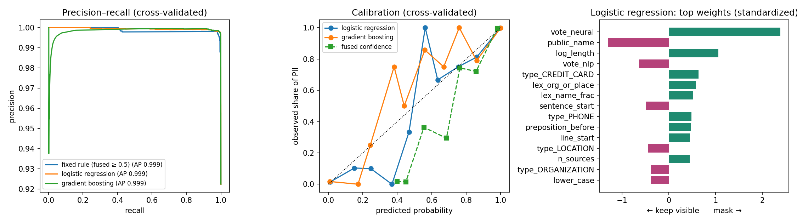
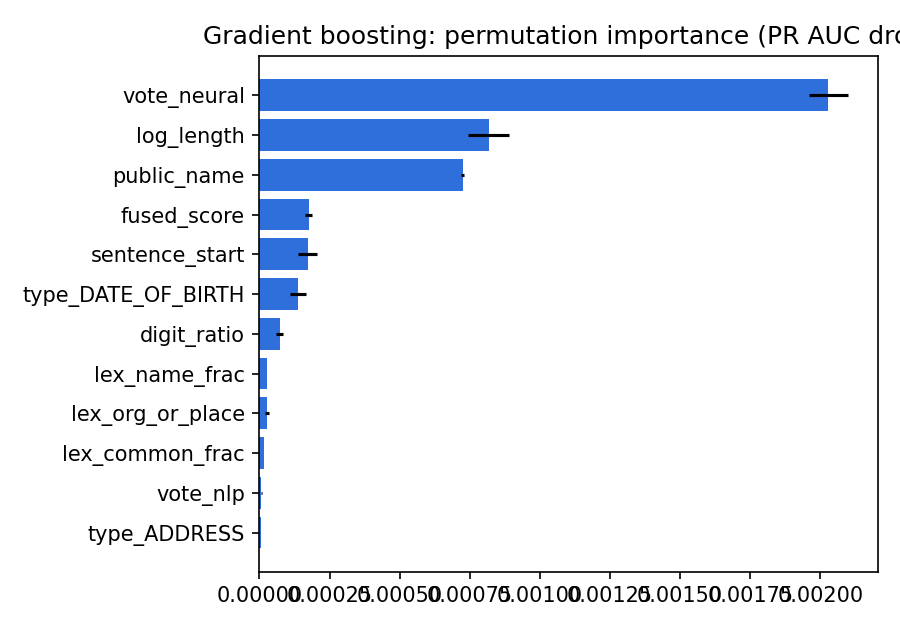

# Decision classifier results

Training data: 10,786 candidates from the validation split (92.2% personal data), 38 features. Shipped model: **logistic regression**.

## 5-fold grouped cross-validation (validation split)

| Model | ROC AUC | PR AUC | Precision | Recall | F1 | Public names kept | Brier |
| --- | ---: | ---: | ---: | ---: | ---: | ---: | ---: |
| fixed rule (fused ≥ 0.5) | 0.989 | 0.999 | 0.984 | 0.999 | 0.992 | 0.916 | 0.022 |
| logistic regression | 0.995 | 0.999 | 0.997 | 0.998 | 0.998 | 0.998 | 0.004 |
| gradient boosting | 0.995 | 0.999 | 0.997 | 0.998 | 0.997 | 0.998 | 0.005 |

## test_synthetic (2,036 candidates)

| Model | ROC AUC | PR AUC | Precision | Recall | F1 | Public names kept | Brier |
| --- | ---: | ---: | ---: | ---: | ---: | ---: | ---: |
| fixed rule (fused ≥ 0.5) | 0.974 | 0.997 | 0.974 | 0.997 | 0.985 | 0.824 | 0.030 |
| logistic regression | 0.995 | 1.000 | 0.982 | 0.998 | 0.990 | 0.963 | 0.015 |
| gradient boosting | 0.995 | 1.000 | 0.987 | 0.998 | 0.993 | 0.972 | 0.011 |

## test_realistic (129 candidates)

| Model | ROC AUC | PR AUC | Precision | Recall | F1 | Public names kept | Brier |
| --- | ---: | ---: | ---: | ---: | ---: | ---: | ---: |
| fixed rule (fused ≥ 0.5) | 0.920 | 0.956 | 0.918 | 0.968 | 0.942 | 0.862 | 0.103 |
| logistic regression | 0.952 | 0.976 | 0.945 | 0.925 | 0.935 | 0.931 | 0.082 |
| gradient boosting | 0.967 | 0.986 | 0.935 | 0.935 | 0.935 | 0.931 | 0.080 |

## test_ai4privacy (2,716 candidates)

| Model | ROC AUC | PR AUC | Precision | Recall | F1 | Public names kept | Brier |
| --- | ---: | ---: | ---: | ---: | ---: | ---: | ---: |
| fixed rule (fused ≥ 0.5) | 0.994 | 1.000 | 0.986 | 0.999 | 0.993 | 0.941 | 0.014 |
| logistic regression | 0.999 | 1.000 | 0.998 | 0.998 | 0.998 | 0.941 | 0.003 |
| gradient boosting | 0.999 | 1.000 | 0.998 | 0.997 | 0.998 | 0.941 | 0.004 |

## Shipped operating point: logistic regression at p ≥ 0.15 (Balanced) with the identifier safety floor

The cut-off is the highest whose cross-validated recall matches the fixed rule (0.9989). It was chosen on the validation split, never on test data. Policies: strict 0.075, balanced 0.15, relaxed 0.5. Formatted identifiers that the rules score ≥ 0.7 cannot be vetoed.

| Model | ROC AUC | PR AUC | Precision | Recall | F1 | Public names kept | Brier |
| --- | ---: | ---: | ---: | ---: | ---: | ---: | ---: |
| fixed rule (fused ≥ 0.5) · test_synthetic | 0.974 | 0.997 | 0.974 | 0.997 | 0.985 | 0.824 | 0.030 |
| logistic regression @ 0.15 + safety floor · test_synthetic | 0.994 | 1.000 | 0.979 | 1.000 | 0.989 | 0.917 | 0.015 |
| fixed rule (fused ≥ 0.5) · test_realistic | 0.920 | 0.956 | 0.918 | 0.968 | 0.942 | 0.862 | 0.103 |
| logistic regression @ 0.15 + safety floor · test_realistic | 0.949 | 0.976 | 0.929 | 0.978 | 0.953 | 0.897 | 0.077 |
| fixed rule (fused ≥ 0.5) · test_ai4privacy | 0.994 | 1.000 | 0.986 | 0.999 | 0.993 | 0.941 | 0.014 |
| logistic regression @ 0.15 + safety floor · test_ai4privacy | 0.999 | 1.000 | 0.997 | 0.999 | 0.998 | 0.941 | 0.004 |

Precision, recall and F1 are at probability 0.5, the Balanced policy. *Public names kept* = share of candidates on public entities (Google, India…) that the model leaves visible.

